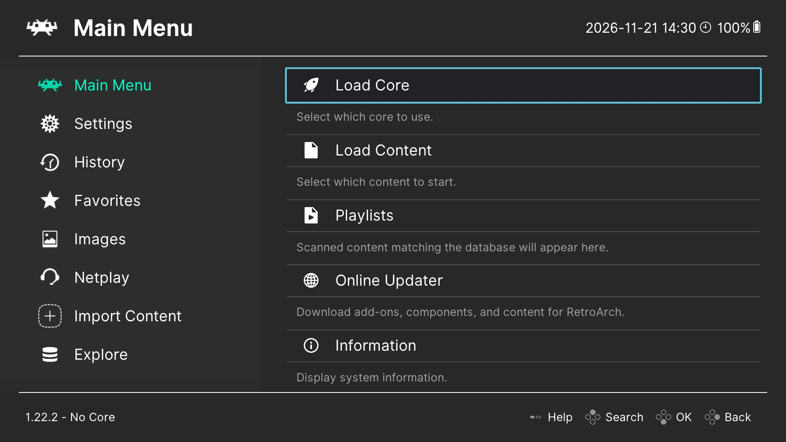
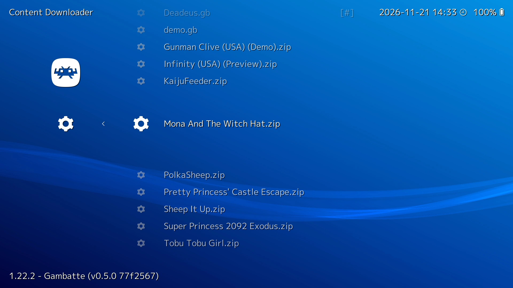

# RetroArch Tizen

This is a Tizen port of RetroArch, for Samsung TVs running Tizen OS 5.5 and above.

## Quick Start

- Install the app to your TV using [Apps2Samsung](https://github.com/Apps2Samsung/Apps2Samsung) (search for RetroArch, dust-7 variant).
  - Or, download `RetroArch_v*.wgt` from [the latest release](https://github.com/dust-7/retroarch-tizen/releases/latest), under **Assets**.
- Run RetroArch on your TV. It starts with no cores and contents.
- To download a core, go to **Main Menu > Load Core > Download a Core**.
- To download free content, go to **Main Menu > Online Updater > Content Downloader**.
  - Load the content by going to **Main Menu > Load Content > Downloads**.
- To load your own content, use a USB storage device.
  - Create a folder named `retroarch` on the root of the device and store your files there.
  - Plug the device to the TV. All files within `retroarch` will be synced and saved locally.
  - Load the content by going to **Main Menu > Load Content > Start Directory**.

## Tips

### TV remote

You can navigate the app with the TV remote. Most buttons can be rebound.

The **Back** button defaults to Escape, and allows you to exit the app. If you wish to rebind it to a menu back action:
- Go to **Settings > Input > RetroPad Binds > Port 1 Controls > A Button (Right)** and map it to **Back** button.
- Next, go to **Settings > Input > Hotkeys > Quit** and map it to another button.
- Finally, save your config by going to **Main Menu > Configuration File > Save Current Configuration**.

While a content is loaded (i.e. you're in a game), you can press the **Red A** or **Play/Pause** button to toggle the Quick Menu.

### External USB storage devices

When a `retroarch` folder is found in the root of a storage device, the contents are synced and persist on the app:
- Only the files and folders within `retroarch` will be transferred.
- The contents will be synced to Start Directory (one way sync).
- Contents not in `retroarch` will be removed from Start Directory.
- The contents are stored locally and persist on app restart, even after unplugging the storage device.

If a `retroarch` folder is not found in the root of a storage device, the device is mounted temporarily:
- The device will be mounted to `/mnt/`, e.g. `/mnt/removable_sda1/`.
- To load content from the device, go to **Main Menu > Load Content > / > mnt > removable_sd\***.
- When the device is unplugged, the mounted folder will be removed.

### Console

You can view the console by pressing the **Info** button on your TV remote or **~** (Shift + `) on your keyboard.

## Benchmarks

Some load times as experienced on a Samsung Q90 series TV:

**Fresh install**

- First app run, loading to menu: 21s
- Subsequent app runs, loading to menu: 6s
- Menu restart (no core): 2.5s

**With Gambatte core**
- Loading Gambatte immediately after downloading: 18s
- Subsequent Gambatte loads: 2.5s

**With FBNeo core**
- From no core, load Metal Slug content: 24s
  - Average FPS: 57-60

## Unstable (v0.x)

This app is still undergoing heavy development and is likely to be unstable. Features may be added, removed, or moved around. The app may crash unexpectedly. If you wish to avoid these early development issues, check back when the release reaches v1.x.

## Known Issues

### The app lags when large files are downloaded

**Symptom:** Immediately after downloading a large core or transferring large amounts of data from USB storage, the UI becomes laggy.

**Cause:** Persistent storage for downloaded files is currently implemented using IndexedDB. When data is being stored in IndexedDB, it takes some time for it to be processed and written to disk.

**Solution:** Leave the app idle and give it some time to process the data. If mounting a USB storage, create a `retroarch` root folder so that only files within that folder are transferred. Keep the number and size of files to a minimum.

**Plan:** Migrate from IndexedDB to WasmFS + OPFS. This requires converting the app from single-threaded to multi-threaded, and should drastically improve performance.

### The app takes much longer than before to start up

**Symptom:** When starting the app, the loading screen is shown for much longer than usual. After loading, the app behaves normally.

**Cause:** Persistent storage for downloaded files is currently implemented using IndexedDB. When starting the app, the filesystem needs to be initalized. Keeping large amounts of downloaded files directly contributes to a longer app start up time.

**Solution:** This only affects the initial loading time when starting the app. If this bothers you, reduce the total amount of data stored. Delete large cores and keep downloaded files to a minimum.

**Plan:** Migrate from IndexedDB to WasmFS + OPFS. This requires converting the app from single-threaded to multi-threaded, and should drastically improve performance.

### The cores list is missing X core

**Symptom:** The list in **Main Menu > Load Core > Download a Core** is missing your favourite core.

**Cause:** Development is currently focused on improving general performance, so expanding the cores list is not prioritised.

**Solution:** If you want a core added, [create an issue](https://github.com/dust-7/retroarch-tizen/issues) for the core (or a list of cores). If the core already contains a build target for Emscripten (many cores do), it should be fairly trivial to add it in.

## Credits

This app relies heavily on the open source codebase from [RetroArch](https://github.com/libretro/RetroArch) and its [Emscripten build path](https://github.com/libretro/RetroArch/blob/master/pkg/emscripten/README.md) in particular. This app would not have been possible without their work.
